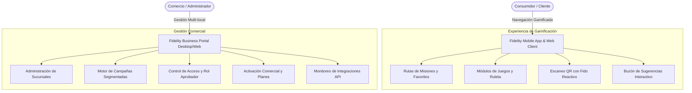
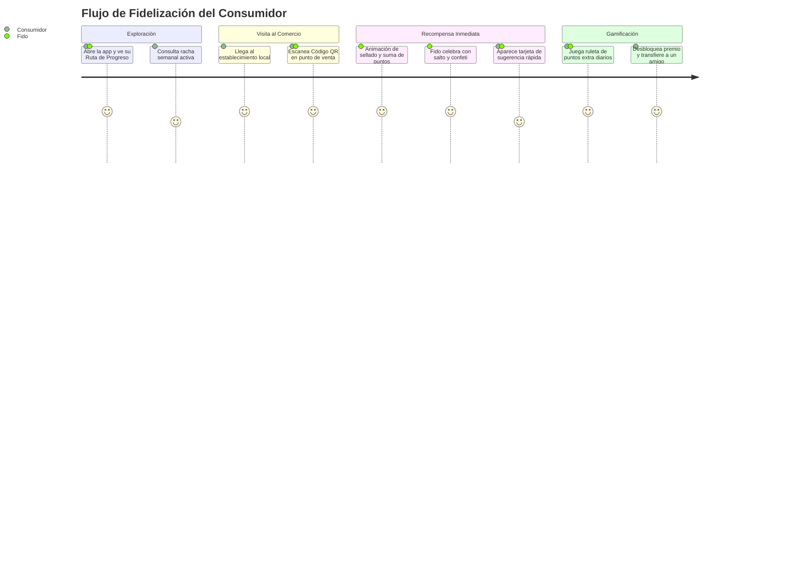

# Especificación Integral de Diseño UX/UI y Conceptualización - Plataforma Fidelity

---

## 1. Visión General del Producto y Propósito Estratégico

La plataforma **Fidelity** evoluciona el modelo tradicional y pasivo de tarjetas de sellos hacia un ecosistema omnicanal interactivo y de alta fidelización. Mediante una arquitectura de **gamificación progresiva inspirada en mecánicas de retención de Duolingo**, Fidelity conecta a consumidores y comercios locales a través de:

- **Ecosistema Multi-comercio Unificado:** Un único perfil permite interactuar con múltiples marcas, desbloquear rutas de consumo y acumular recompensas transversales o exclusivas por comercio.
- **Guía Omnipresente ("Fido"):** Un asistente y avatar de marca reactivo que acompaña al usuario en cada hito, celebración, soporte y flujo transaccional.
- **Panel Administrativo Multi-sucursal para Comercios:** Control centralizado de locales, campañas de marketing dirigidas, gestión de accesos con jerarquía de aprobación y activación ágil mediante el flujo comercial de membresías.

---

## 2. Mascota de Marca: "Fido" (Guía de Experiencia)

### 2.1. Identidad y Personalidad
- **Arquetipo:** El compañero leal, entusiasta y motivador del ahorro y la diversión.
- **Rol en la Interfaz:** Mentor visual no intrusivo. Proporciona micro-orientación contextual, refuerzo positivo inmediato y retroalimentación empática.
- **Lenguaje Corporal:** Dinámico, gestos claros, postura abierta y adaptable a diferentes niveles de energía (desde calma en formularios hasta euforia en canjes).

### 2.2. Matriz de Estados Emocionales y Micro-Animaciones

| Contexto / Disparador | Estado Emocional de Fido | Animación & Efecto Visual | Microcopy Asociado |
| :--- | :--- | :--- | :--- |
| **Inicio de Sesión / Bienvenida** | Alegre y acogedor | Saludo con la mano y destello sutil | "¡Qué alegría verte de vuelta! Tus rutas te esperan." |
| **Escaneo de QR Exitoso** | Celebración triunfal | Salto enérgico con efecto de confeti radial | "¡Punto acumulado! Estás más cerca de tu meta." |
| **Peligro de Cooldown / Escaneo Bloqueado** | Pensativo / Paciente | Señalando un reloj de arena animado | "Aún falta un poco para tu próximo sello en este local." |
| **Racha Semanal Mantenida** | Entusiasmado con fuego | Portando una antorcha con multiplicador | "¡Racha de 4 días activa! Multiplicador x1.5 activado." |
| **Canje de Recompensa** | Éxito total | Presentando caja de regalo dorada con destellos | "¡Premio desbloqueado! Muéstralo en caja para canjear." |
| **Buzón de Sugerencias y Reclamos** | Empático y atento | Libreta de apuntes en mano con mirada receptiva | "Tu opinión hace crecer este lugar. Cuéntanos qué tal todo." |
| **Flujo Comercial (PAGA YA)** | Profesional y motivador | Presentando un maletín de crecimiento comercial | "Impulsa tu negocio hoy mismo con Fidelity Pro." |
| **Error de Conexión / Desconexión** | Curioso / Reparador | Sosteniendo una pequeña llave inglesa | "Reintentando conectar con el servidor central." |

---

## 3. Arquitectura de Experiencia del Consumidor (Mobile & Web)

### 3.1. Dashboard de Negocios: Estilo "Ruta de Progreso"
En lugar de un listado estático, la pantalla de inicio adopta un **mapa de progreso lineal interactivo**:
1. **Nodos de Comercio / Estaciones:** Cada negocio donde el usuario tiene una tarjeta activa se representa como una parada en la ruta (ej. *Estación Café Express*, *Punto Gourmet*, *Boutique Moda*).
2. **Indicador de Meta:** Una barra circular o radial perimetral muestra el progreso (ej. `3/5 sellos`).
3. **Misiones Semanales y Colecciones:** Agrupaciones temáticas como "Ruta del Café del Centro" que premian al usuario con un comodín o puntos extra si visita 3 locales de la misma categoría en un periodo determinado.

### 3.2. Módulo de Mini-Juegos y Dinámicas Interactivas
- **Ruleta de Beneficios:** Disponible 1 vez al día o tras acumular una racha mínima de 3 escaneos consecutivos. Otorga sellos comodín, multiplicadores temporales de puntos o cupones de descuento.
- **Raspa y Gana Digital:** Desbloqueable al alcanzar el 80% del progreso en cualquier comercio adherido.
- **Desafíos Temporales:** Retos basados en tiempo (ej. *"Visita dos sucursales este fin de semana para duplicar tu puntaje"*).

### 3.3. Campañas Dinámicas y Personalizadas
- **Tarjetas Animadas en Carrusel:** Banners interactivos con física elástica (`spring physics`) que destacan ofertas exclusivas enviadas directamente por los negocios a clientes habituales.
- **Geolocalización Inteligente:** Notificación sutil cuando el usuario se encuentra a menos de 200 metros de una sucursal con beneficios pendientes.

### 3.4. Buzón de Sugerencias Conversacional Post-Escaneo
- Al finalizar un escaneo, se despliega una hoja inferior (`BottomSheet`) no intrusiva con 3 niveles rápidos de satisfacción (Excelente, Bueno, Por Mejorar) representados por gestos de Fido.
- Permite escribir una nota breve o seleccionar etiquetas predefinidas (*"Atención rápida"*, *"Excelente ambiente"*, *"Demora en caja"*) que se envían directamente al panel privado del dueño.

---

## 4. Arquitectura de Experiencia del Administrador y Comercio (Panel Web / PC)

### 4.1. Panel de Control de Alta Densidad (Desktop First)
- **Vista Global de Rendimiento:** Tarjetas métricas de visitas del día, tasa de retorno de clientes, escaneos validados y premios pendientes de aprobación.
- **Selector de Idiomas Global:** Menú accesible en el encabezado superior derecho con soporte instantáneo para cambio de idioma en toda la interfaz sin recarga de página.

### 4.2. Gestión Multi-sucursal Centralizada
- Vista de árbol jerárquico o cuadrícula con estado operativo en tiempo real de cada local (horario, responsable en turno, volumen de escaneos).
- Asignación flexible de reglas de fidelización individuales o globales por cadena.

### 4.3. Flujo Comercial y Activación: "Botón PAGA YA"
- Proceso guiado en 3 pasos visuales para la activación de planes comerciales y suscripciones multi-sucursal.
- Integración de pasarelas de cobro seguras con generación de factura inmediata y comprobante digital.

### 4.4. Matriz de Control de Acceso y Rol "Aprobador"
- **Cajero / Operador de Local:** Escaneo de clientes, asignación de puntos autorizados y visualización de tickets de consumo.
- **Rol Aprobador (Supervisor de Sucursal):** Autorización de canjes de premios de alto valor, anulación controlada de operaciones y revisión del buzón de reclamos.
- **Administrador de Cadena:** Configuración de campañas, facturación en PAGA YA, creación de sucursales y gestión de credenciales API.

### 4.5. Monitor de Integración API y Conectividad
- Indicadores visuales de telemetría (Semáforo de estado: En Línea, Latencia Promedio, Última sincronización).
- Registro de llamadas para integración con puntos de venta (POS) y ERPs comerciales.

---

## 5. Sistema de Diseño (Design Tokens y Componentes)

### 5.1. Paleta Cromática Institucional

| Token | Código HEX | Rol Semántico | Aplicación UI |
| :--- | :--- | :--- | :--- |
| `color-primary` | `#1E1E2E` | Fondo y Superficie Oscura | Encabezados, barras de navegación, texto de alto contraste |
| `color-accent` | `#6366F1` | Acento Primario / Interactividad | Botones primarios, nodos activos de ruta, progreso principal |
| `color-success` | `#10B981` | Confirmación / Recompensas | Estados de éxito, sellos validados, premios activos |
| `color-warning` | `#F59E0B` | Advertencia / Cooldown | Barras de tiempo de espera, rachas en peligro, alertas |
| `color-background` | `#F8FAFC` | Fondo Claro Base | Canvas principal de pantallas y aplicaciones |
| `color-surface` | `#FFFFFF` | Tarjetas y Contenedores | Elevaciones de tarjetas, modales y hojas inferiores |

### 5.2. Tipografía y Jerarquía
- **Display / Títulos:** *Anton* (Para números de puntos, encabezados de impacto y nombres de campañas principales).
- **Body / Interfaz:** *Poppins* (Para subtítulos, párrafos, etiquetas de formulario, botones y datos métricos).

### 5.3. Tokens de Movimiento (Motion Guidelines)
- **Duración Estándar:** `250ms` para micro-interacciones (hover, pulsación de botón), `400ms` para transiciones de pantalla, `700ms` para celebraciones y físicas de ruleta.
- **Curvas de Aceleración:** `Cubic(0.34, 1.56, 0.64, 1)` (Efecto elástico para rebotes de Fido y sellos completados).
