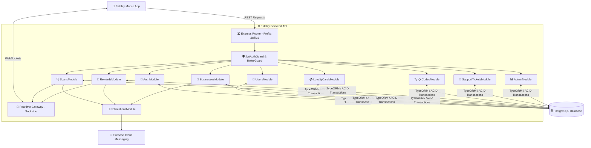

# 📚 Documentación Integral del Sistema Fidelity

## 1. Visión General de la Arquitectura
El sistema Fidelity está compuesto por dos componentes principales desacoplados:
1. **Frontend Mobile (Flutter):** Aplicación móvil multiplataforma desarrollada con Screaming Architecture y Riverpod para clientes, comercios y administradores.
2. **Backend Dedicado (NestJS + Express + PostgreSQL):** API REST y Gateway de WebSockets que concentra toda la lógica de negocio, seguridad, transacciones ACID, notificaciones push (FCM) y streaming en tiempo real.



---

## 2. Especificación de la API REST (`/api/v1`)

### 🔐 Autenticación (`/api/v1/auth`)
- `POST /register`: Registro de cliente o dueño de negocio.
- `POST /login`: Inicio de sesión, validación con bcrypt y emisión de JWT.
- `POST /reset-password`: Solicitud de restablecimiento de contraseña.
- `GET /me`: Consulta del perfil del usuario autenticado.

### 👤 Usuarios y Perfiles (`/api/v1/users`)
- `GET /profile`: Perfil actual.
- `PUT /profile`: Edición de nombre, teléfono y avatar.
- `PATCH /fcm-token`: Actualización del token FCM para notificaciones push.
- `GET /search?q=`: Búsqueda de usuarios para transferencias.
- `DELETE /account`: Eliminación en cascada integral de la cuenta y sus datos.

### 🏢 Negocios (`/api/v1/businesses`)
- `GET /`: Listado de comercios activos.
- `GET /categories`: Categorías de comercios disponibles.
- `POST /`: Creación de comercio por un dueño.
- `GET /:id`: Detalles del comercio.
- `PUT /:id`: Actualización de datos del comercio.
- `GET /:id/stats`: Estadísticas de clientes, escaneos y recompensas.
- `PATCH /:id/status`: Activación o bloqueo del comercio (Solo Admin).

### 💳 Tarjetas de Fidelidad (`/api/v1/loyalty-cards`)
- `GET /my-cards`: Tarjetas activas del cliente autenticado.
- `POST /get-or-create/:businessId`: Obtención o inicialización segura de tarjeta en 0 puntos.
- `GET /business/:businessId`: Directorio de clientes de un comercio.
- `GET /:id/history`: Historial completo de escaneos, premios y transferencias de la tarjeta.

### 🔍 Escaneos y Cooldown (`/api/v1/scans`)
- `POST /validate`: Validación de escaneo QR con control riguroso de ventana de *cooldown*, acumulación de puntos y disparo de premios al alcanzar la meta.
- `POST /manual-points`: Asignación manual de puntos por parte del dueño.
- `GET /business/:businessId`: Historial de escaneos del comercio.
- `PATCH /:id/status`: Aprobación o rechazo de escaneo pendiente.

### 🎁 Premios y Transferencias (`/api/v1/rewards`)
- `GET /my-rewards`: Premios obtenidos por el cliente.
- `GET /business/:businessId`: Premios pendientes y entregados del comercio.
- `PATCH /:id/status`: Aprobación (`approved`/`claimed`) o rechazo del premio.
- `POST /transfer`: Transferencia atómica de premio a otro usuario.
- `GET /transfers`: Historial de transferencias.

### 📊 Administración (`/api/v1/admin`)
- `GET /stats`: Métricas globales del sistema.
- `GET /users`: Listado de usuarios con filtros y búsqueda.
- `GET /activity`: Flujo en vivo de escaneos y premios recientes.
- `PATCH /users/:id/role`: Asignación y cambio de roles de usuario.

---

## 3. Despliegue y Ejecución Local del Backend

1. **Instalar dependencias:**
   ```bash
   cd backend
   npm install
   ```
2. **Configurar variables de entorno:**
   Copiar `.env.example` a `.env` y configurar credenciales de PostgreSQL y JWT.
3. **Ejecutar en modo desarrollo:**
   ```bash
   npm run start:dev
   ```
4. **Ver documentación Swagger OpenAPI:**
   Acceder en el navegador a `http://localhost:3000/api/docs`.
5. **Ejecutar pruebas automatizadas:**
   ```bash
   npm test
   ```
